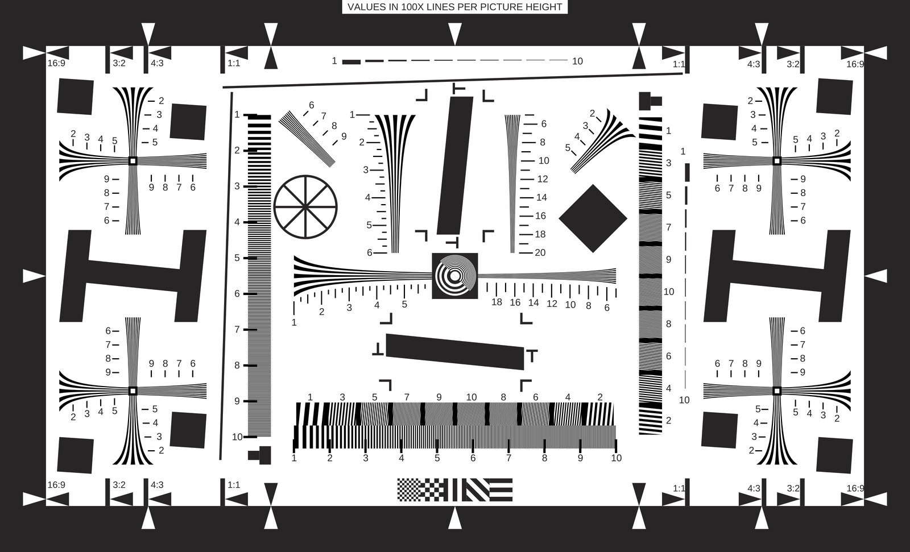

# ISO12233

A Python + drawsvg reconstruction of Stephen H. Westin's ISO12233:2000
resolution chart, for camera simulation and image-quality/ISP experiments.
This is a measured reconstruction of Westin's artwork, not a certified ISO
test target or an independently verified implementation of the ISO standard.



## Generate

Python 3.10 or later is required. No original PDF/SVG, system fonts, Cairo,
Octave, ISETCam, or network connection is needed after installation.

```bash
python3 -m venv .venv
source .venv/bin/activate
pip install -r requirements.txt
python generate_chart.py --output output/iso12233.svg
python generate_chart.py --output output/iso12233.svg --png output/iso12233.png --width 8192
```

The PNG is **8192 x 4970**, preserving the source aspect ratio rather than
stretching it to a 4:3 sensor canvas. PNG rendering uses PyMuPDF at 2x sampling
followed by Lanczos reduction. SVG remains resolution independent. To simulate
a differently shaped sensor, fit the chart into that canvas in the camera
simulation stage.

The cropped SVG viewBox is `0 0 1121.273 680.314`, in 1/72-inch points.
The outer frame is approximately 395.56 x 240 mm. The inner white rectangle
is approximately 355.56 x 200 mm. **LW/PH frequency labels refer to the
inner active picture height, not the height of the outer black frame.**
Changing label text alone does not change a pattern's physical frequency.

## What is parameterized

`chart_measurements.json` contains 20 named components, 1,154 painted shapes,
159 labels, and 382 reusable primitives. It stores rectangle widths/heights,
relative polygon vertices, polyline coordinates, and measured cubic/linear
contours, separately from per-instance placement and paint styles. It has no
SVG path strings, font blobs, or embedded reference document.

For example, moving an instance's `origin` moves that shape; changing a
rectangle primitive's `width` modifies every instance sharing that primitive.
To change one instance only, duplicate its primitive and update its index.
All repeated contours share the same renderer. Component IDs preserve the
source names for wedges, sweeps, bars, checkerboard, arrows and zone plate.

This first version deliberately preserves measured contour samples and the
source's small asymmetries. **It does not replace every wedge/sweep with an
ideal analytic frequency formula.** Such a replacement would be a different
chart and would require separate frequency validation. Labels are rendered
as Liberation Sans outlines at their measured baselines/sizes, ensuring
portable appearance. Their glyphs differ from Westin's Myriad/Arial labels.
The printing footer is omitted; source attribution lives in this README,
NOTICE and SVG metadata.

## Re-measure and validate

Obtain the reference documents as described in [references/README.md](references/README.md).
Reference files are not tracked. Measurement/validation dependencies are
included in requirements.txt; normal generation only uses the checked-in
measurements and open font.

```bash
python measure_chart.py --reference references/ISO_12233-reschart.svg --output chart_measurements.json
python validate_chart.py --reference references/ISO_12233-reschart.svg --output output/validation
python -m unittest -v test_chart
```

Validation checks independent source/generated line and cubic control-point
coordinates, paint styles, and all shape counts. It compares label-free
geometry using the same renderer at 2048 and 8192 pixels and separately
compares PDF layer vertices/control points after frame alignment. The JSON
report includes per-component bounds, coordinate errors, raster statistics,
and PDF differences. Overlay, amplified difference images and six detailed
side-by-side crops are also produced. See [VALIDATION.md](VALIDATION.md).

## Sources and licenses

- Chart artwork and derived measurement data: Stephen H. Westin / Cornell
  University Program of Computer Graphics, copyright 2004. See
  [author's page](https://www.graphics.cornell.edu/~westin/misc/res-chart.html).
  No blanket open-source license for this artwork has been established.
  Reconstructing it does not make it CC0. This repository is currently local.
- Python source files: MIT, see LICENSE. This grant does **not** cover the
  measured artwork, generated chart images, or the original reference files.
- Liberation Sans Regular 2.1.5: SIL Open Font License 1.1; copyright and
  license retained in `fonts/LICENSE`, with authors in `fonts/AUTHORS`.

No RAW images or sensor simulation results are included here. Existing
ISO12233_Simulation data and code were not changed by this project.
