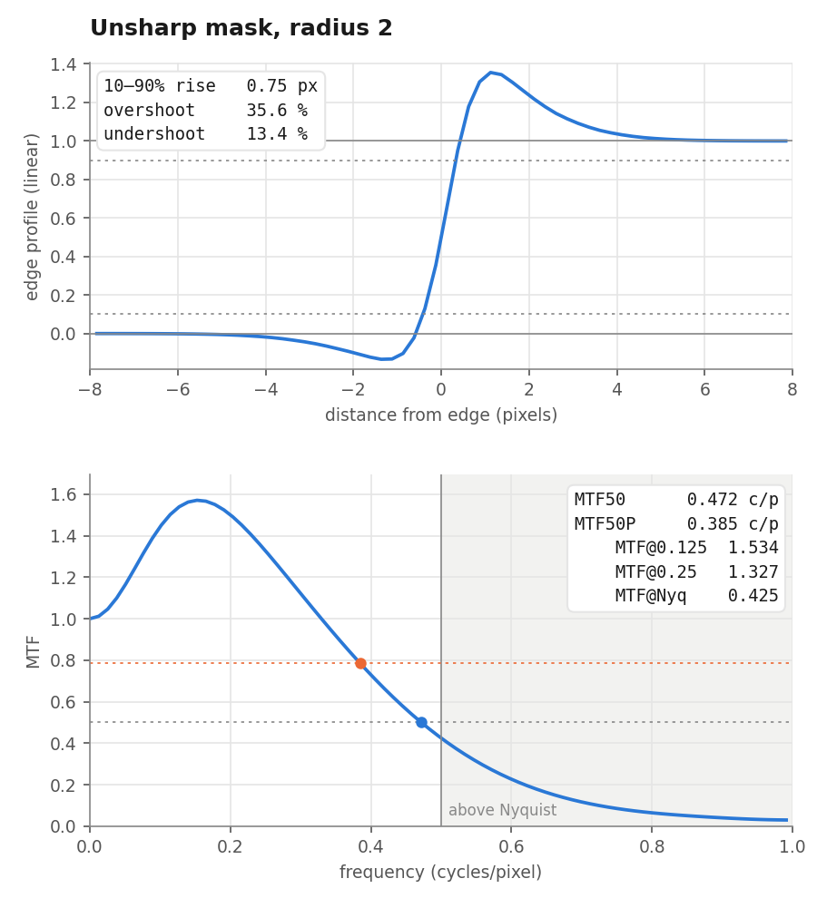

# ISO12233

Python + drawsvg test-chart generation for camera simulation and image-quality/ISP
experiments. Four chart families are available: a measured Westin ISO12233:2000
reconstruction, CIPA resolution wedges, e-SFR slanted stars and s-SFR sine stars.

These are synthetic chart inputs, not captured RAW images. The modern charts
are reconstructed from public references; they are not certified ISO targets.

## Choose a chart

| Chart | Purpose | Size | SVG | PNG | Parameters |
|---|---|---|---|---|---|
| ISO12233:2000 | Classic bars, wedges, sweeps and zone plate | 8192×4970 | [SVG](charts/iso2000/chart.svg) | [PNG](charts/iso2000/preview-8192.png) | [Measurements](data/iso2000_measurements.json) |
| CIPA | Visual resolution, five-line wedges and sweeps | 8192×5783 | [SVG](charts/cipa/chart.svg) | [PNG](charts/cipa/preview-8192.png) | [JSON](charts/cipa/metadata.json) |
| e-SFR | Nine slanted stars, 4:1 linear contrast | 8192×5783 | [SVG](charts/esfr2024/chart.svg) | [PNG](charts/esfr2024/preview-8192.png) | [JSON](charts/esfr2024/metadata.json) |
| s-SFR | Nine sinusoidal stars, 144 cycles | 8192×6201 | [SVG](charts/ssfr/chart.svg) | [PNG](charts/ssfr/preview-8192.png) | [JSON](charts/ssfr/metadata.json) |

[Preview the three modern charts together](charts/modern-contact-sheet.png) ·
[Classic chart thumbnail](charts/iso2000/thumbnail.png)

Each chart has one folder in `charts/`, with consistent `chart.svg`,
`preview-8192.png` and, for modern charts, `metadata.json` filenames.

## Install and generate

Python 3.10 or later. Run commands from the repository root:

```bash
git clone https://github.com/hujunhan/ISO12233.git
cd ISO12233
python3 -m venv .venv
source .venv/bin/activate
pip install -r requirements.txt

# Classic chart
python -m iso12233.generate_chart --chart iso2000 \
  --output output/runs/iso2000/chart.svg --png output/runs/iso2000/preview.png --width 8192

# Linear-reflectance data for optical/sensor simulation
python -m iso12233.generate_chart --chart esfr2024 \
  --output output/runs/esfr2024/chart.svg --linear output/runs/esfr2024/reflectance.npy \
  --png output/runs/esfr2024/preview.png --metadata output/runs/esfr2024/metadata.json --width 8192

# Single sine star, 72 cycles
python -m iso12233.generate_chart --chart ssfr --ssfr-layout single --cycles 72 \
  --output output/runs/ssfr72/chart.svg --linear output/runs/ssfr72/reflectance.npy --width 4096
```

Use `--chart cipa`, `esfr2024` or `ssfr` for the modern families. Add
`--supersample 8` or `16` for more precise subpixel integration. Keep the chart's
aspect ratio and fit it into the sensor canvas during camera simulation.
Generation runs offline after installation; original reference files are needed
only for re-measurement and comparison against the source.

For simulation, use float32 **linear reflectance NPY**, not the display PNG.
Modern PNG/SVG display assets use sRGB encoding; the legacy display retains
Westin's artwork colors. Modern metadata records reflectance, geometry,
frequency definitions, sampling and parameter provenance. The legacy `--linear`
option assumes neutral black=0 and white=1. NPY data are generated locally and
are not included in Git.

## Repository layout

```text
ISO12233/
├── iso12233/          Python generator, measurement and validation modules
├── data/              Measured legacy geometry, modern profiles and source inventory
├── charts/            Ready-made SVG/PNG/JSON, one folder per chart family
│   ├── iso2000/
│   ├── cipa/
│   ├── esfr2024/
│   └── ssfr/
├── docs/              Reconstruction methods and validation explanations
├── reports/           Published numerical reports: iso2000/ and modern/
├── tests/             Geometry, reflectance, sampling and CLI tests
├── assets/fonts/      Bundled open font and its license
├── references/        Locally downloaded original references (ignored by Git)
└── output/            Local generated data and experiments (ignored by Git)
    ├── linear/        Existing full-resolution NPY data
    ├── benchmarks/    Local generation timing and memory logs
    ├── validation/    Validation previews and reports
    ├── runs/          Suggested destination for new generations
    └── archive/       Preserved earlier experimental outputs
```

`charts/` holds the distributable examples; `output/` is the local workspace.
Earlier experiments have been moved into `output/archive/`.

## Measure sharpness (slanted-edge SFR)

`iso12233.sfr` measures MTF from a slanted edge with a NumPy port of sfrmat5,
and adds 10–90% rise, overshoot, MTF50 and MTF50P. It is validated against
closed-form Gaussian and unsharp-mask edges. `iso12233.sfr_appearance` shows
how sharpening and blur change both the MTF curve and a real photo.

```bash
pip install -r requirements-sfr.txt
python -m iso12233.sfr_report roi.npy --title "My lens" --output report.png
```



Method, metric definitions, validation and the appearance study: [docs/sfr.md](docs/sfr.md).

## Details and verification

- [Classic chart geometry, wedges and sweeps](docs/iso2000-chart.md)
- [Modern chart formulas, reference measurements and approximation limits](docs/modern-charts.md)
- [Classic source validation](docs/iso2000-validation.md) · [Report](reports/iso2000/geometry.json)
- [Modern sampling and reference comparison report](reports/modern/validation.json)
- [Modern parameter profiles](data/modern_profiles.json) · [Public source inventory](data/modern_references.json)
- [Slanted-edge SFR: method and validation](docs/sfr.md) · [Appearance study](reports/sfr-appearance/summary.json)
- [Original reference downloads](references/README.md)

```bash
python -m unittest discover -s tests -v
python -m iso12233.generate_chart --help
```

The 28 tests cover geometry, reflectance, frequency, tile independence, CLI
outputs and slanted-edge SFR against closed-form edges. Full source comparisons require local reference downloads. Modern
production validation also requires the local NPY data corresponding to the
published metadata; see [the validation instructions](docs/modern-charts.md#validation-and-limits).

## Sources and licenses

Python code is MIT; this does not grant rights to the referenced artwork,
measured chart data or generated images. The classic artwork is based on
Stephen H. Westin / Cornell (2004). Modern references and changes are recorded
in [NOTICE](NOTICE) and the [source inventory](data/modern_references.json).
Liberation Sans is bundled under SIL OFL 1.1; see [its license](assets/fonts/LICENSE).
`iso12233/sfrmat5.py` is a port of sfrmat5 by Peter D. Burns and keeps its BSD
license. The demo photo is CC0 (Wilfredor, Wikimedia Commons).

See [LICENSE](LICENSE) and [NOTICE](NOTICE) before redistributing chart artwork.
